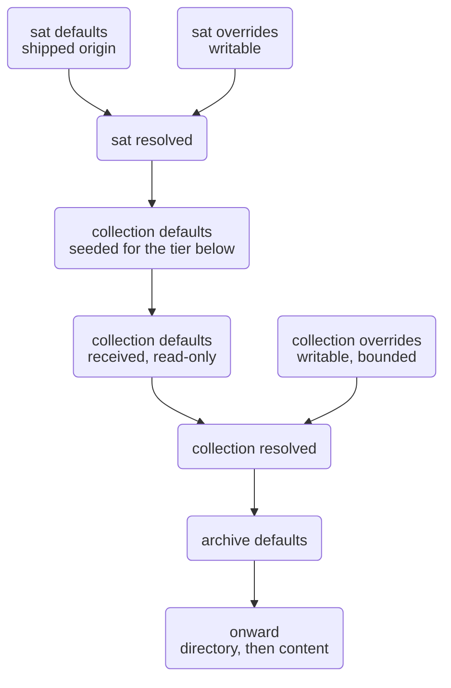

---
# Generated by the SAT front matter creator for Eleventy ingress. Do not edit by hand.
# Canonical metadata lives in the resource sidecar.
layout: layouts/document.njk
title: "SAT Configuration Cascade Specification"
description: "The configuration cascade as it stands: path shape, authority, file format, field contents, and where resolution runs. Consolidates and supersedes six earlier drafts."
lang: en-CA
dir: ltr
date: 2026-09-09
author: Christopher Steel
rights: "AGPL-3.0-or-later"
version: 0.2.2
status: provisional
dc:
  title: ["SAT Configuration Cascade Specification"]
  creator: ["Christopher Steel"]
  subject: ["sat", "configuration", "cascade"]
  date: ["2026-09-09"]
  type: ["Text"]
  format: ["text/html"]
  identifier: ["urn:uuid:7d8598d9-2b58-4198-ac23-2d24e07a3c4e"]
  language: ["en-CA"]
  rights: ["AGPL-3.0-or-later"]
sat:
  identifier: "urn:uuid:7d8598d9-2b58-4198-ac23-2d24e07a3c4e"
  isVersionOf: "urn:uuid:bf66e60e-9589-42d0-b999-7ae23c7ee34f"
  slug: "sat-configuration-cascade-specification"
---

# SAT Configuration Cascade Specification

## Purpose

This document describes the SAT configuration cascade as it stands, in one place, as the design `sat init` is to be built from.

It consolidates and supersedes six drafts: the Authority Model, the File Hierarchy Overview walkthrough, the four `config.yml` contents drafts, and the cascade details note. Where those disagreed, the more recent statement is taken, and every remaining disagreement is listed under Conflicts rather than silently resolved.

## Provenance markers

`[D]` decided, carried from a source document. `[I]` inferred from a decision already made, needing confirmation rather than argument. `[P]` proposed, not yet decided. `[C]` carried from a superseded document, uncontradicted by anything newer, and worth confirming.

## Vocabulary

`[D]` **Node.** A directory or file that SAT describes. A node carries a sidecar, holds one or more roles from the role vocabulary, and takes its defaults from the node above it. A node with nothing above it is the origin of the cascade, and its defaults are given rather than received.

`[D]` **Organizing directory.** A directory that carries no sidecar and therefore no configuration or metadata of its own. It is not a node, holds no role, and the cascade steps through it as though it were not there. Its contents belong to the nearest node above it, which is what describes and owns them. `bin/` and `lib/` inside a SAT instance are organizing directories: the SAT instance root describes them and sets ownership and permissions for them. They require no metadata and no configuration of their own.

`[D]` **Root.** The top node of a tree or subtree. The instance root is the origin of the cascade: the only node whose `defaults/` are shipped rather than received. A collection root is the top node of a collection — a root of its own subtree, but still receiving its defaults from the node above it.

`[D]` **Node name.** The name of the node as it appears on disk. For a directory node, the directory name. For a file node, the file name including its extension, because the sidecar is named from it and two files differing only by extension would otherwise resolve to one sidecar name. Whether two such files are related, and how, is a metadata question answered by the relation model rather than by their names.

`[D]` **Role.** `sat`, `collection`, `archive`, `directory` and `content` are the five possible roles. A node's type is its role, or the list of roles it holds. The role vocabulary is declared once at the instance root and used on both role axes.

`[D]` **Sidecar.** `.{node name}.assets/`, holding all SAT-owned material for that node.

`[D]` **Author.** The authoring role that owns and writes a body of material. The first segment inside a sidecar.

`[D]` **Subject.** The role a body of material is addressed to. Always the author's own role or one below it.

`[D]` **State.** One of `defaults/`, `overrides/`, `resolved/`.

`[D]` **`"<notset>"`.** The literal string written as a field's `value` when no value has been declared. It makes an undeclared field visible when debugging a cascade, and it is what causes `sat init` to prompt in some cases. A field carrying it has nothing for a lower tier to lose to.

`[D]` **Instance.** A single installation of SAT. Its root node and everything SAT ships beneath it: `bin/`, `lib/`, and SAT's own language archives carrying `locale/` and `docs/`. All of it is authored by the `sat` role, owned by the sat group, and versioned with the software. An instance holds the software and SAT's own documentation in whatever languages are available; it does not hold an archivist's materials, though it is what creates and manages them. The active instance is resolved from the running executable rather than from a stored pointer — see *Locating the active instance*.

`[D]` **Collection.** A body of archives and archivist's material, and the directory SAT manages it in.

`[D]` **Archive.** A language scope within a collection, holding the `archive` role. A multilingual site is a collection containing one archive per language. Language is the only axis that forms archives — see *Axes and the archive boundary*.

`[D]` **Work.** The abstract content a set of expressions realises, independent of language and of every other axis. A work is identified by a `urn:uuid` and has no node of its own: it exists as the value that content nodes point at, and the work index is its materialisation.

`[D]` **Expression.** A realisation of a work at one set of axis coordinates. A content node is an expression. Two content nodes are expressions of one work when they carry the same `isVersionOf`.

`[D]` **Axis.** A dimension along which the expressions of one work vary: language, register, modality. An axis is *archive-scoped* if its values partition the collection into archives, or *resource-scoped* if its values are recorded on the resource. Language is the only archive-scoped axis.

## Axes and the archive boundary

`[D]` Language is the only axis that forms archives. An archive directory is named for a language and holds the `archive` role; no other axis ever appears as a directory below the collection. `content/en-ca/` is an archive. `content/en-ca__easy/` is not, and a resolver encountering it should report an undeclared archive rather than inventing an axis.

`[D]` Every other axis is recorded on the resource, in its own metadata, and never in a path. Two expressions of one work differing only by register sit in the same directory of the same archive:

```text
en-ca/areas/legal/privacy/privacy-in-quebec.md
en-ca/areas/legal/privacy/privacy-in-quebec-easy.md
```

Both are content nodes carrying the same `isVersionOf` and different `register`. The directories between the archive and the resource are subject organization: they say what a document is about, not what coordinates it holds.

`[D]` The reason the two are not symmetrical is that language is the only axis a whole tree can be scoped to without lying. Archive-scoping an axis asserts that everything beneath shares that value, and that assertion holds for language — `en-ca/` is English throughout — where for register it would not: a directory of standard-register documents acquires an easy-read sibling the moment one is written, and the tree would have to be restructured to hold it. Resource-scoping costs one metadata field and never restructures anything.

`[I]` A resource-scoped axis value may be reflected in the node name as a suffix — `-easy` — so variants sort together in a listing. This is an authoring convention and carries no authority. The metadata is what SAT reads; a resolver may cross-check the two and report a disagreement, but it never parses the coordinate out of the name. Names are for humans, and a name that disagreed with the metadata would otherwise become a second source of truth.

`[P]` Whether that cross-check is a warning or an error is not settled. Listed under Open questions.

## Node examples

The SAT instance root is a node holding the roles whose defaults ship with SAT.

A collection is a node holding the `collection` role. Its defaults arrive across the role boundary. A collection inside another collection is the same, taking its defaults from the collection above it.

An archive, a directory and a content file are nodes holding the `archive`, `directory` and `content` roles, taking their defaults from the nodes above them through the configuration and metadata cascades.

A collection root may sit anywhere on the filesystem. It is user-owned, holds no software by default, and carries the defaults it received, which is what makes it portable: it can be moved to another directory or machine and resolves against whatever SAT instance it finds there. A moved collection belongs to the instance it currently resolves against, which need not be the one that created it.

Any file or directory with no sidecar is not a node, which is what keeps organizing directories and ignored files out of the cascade entirely.

## Path shape

`[D]` Configuration files carry two role axes.

```bash
.{level}.assets/{author}/config/{subject}/{state}/config.yml
```

`{level}` is the full **name** of a directory or of a file including its extension. `{author}` and `{subject}` are **roles**. They look like the same kind of thing at the instance root only because that directory happens to be named `sat`. At an archive named `en-ca`, the level is `en-ca` and the author is `archive`.

| Segment | Meaning | Drawn from |
| --- | --- | --- |
| `{level}` | The name of the node the sidecar belongs to: a directory name, or a file name with its extension | The filesystem |
| `{author}` | The role that owns and writes this material | The role vocabulary |
| `{subject}` | The role the material is addressed to | The role vocabulary |
| `{state}` | `defaults/`, `overrides/` or `resolved/` | Fixed set of three |

`[P]` Rename `{level}` to `{node}`. The vocabulary already defines *node name* as exactly what this segment holds, and *level* is a leftover from the walkthrough drafts, where it described a rung in the cascade rather than a name on disk. Keeping both words for one thing costs a reader a translation step on every path. Listed under Open questions; `{level}` is retained throughout this document until it is ruled on, so the rename lands in one pass rather than half of one.

Worked examples:

| Path | Level | Author | Subject |
| --- | --- | --- | --- |
| `sat/.sat.assets/sat/config/collection/defaults/config.yml` | `sat`, the root directory | `sat` | `collection` |
| `en-ca/.en-ca.assets/archive/config/directory/overrides/config.yml` | `en-ca`, a directory node holding the archive role | `archive` | `directory` |
| `.report.md.assets/content/config/content/resolved/config.yml` | `report.md`, a file node | `content` | `content` |

The third example shows the subject axis at its narrowest. A content node is a leaf, so it can address only itself.

### Where a sidecar sits

A sidecar sits in the directory where its node's name resolves.

For a directory node that means inside it: `sat/.sat.assets/`.

For a file node, which cannot contain a directory, the sidecar sits beside it in the same parent directory: `docs/.report.md.assets/` alongside `docs/report.md`.

One consequence follows and is worth knowing before it bites. A directory node moved with `mv` carries its sidecar inside it. A file node moved with `mv` leaves its sidecar behind, because the sidecar is a sibling rather than a child. Either moving a content node is a SAT operation rather than a filesystem one, or the asymmetry is accepted and stated.

`[D]` The author segment is the ownership boundary. Everything beneath `.sat.assets/sat/` belongs to the `sat` role and to nothing else: one `chgrp`, no exceptions inside it, and no other role holding a writable file anywhere in that subtree.

With a single axis, sat's outbound defaults and the receiving role's own edits would share a directory, and ownership would have to be asserted file by file rather than by subtree.

### One author folder per role held

`[D]` A node carries exactly one author folder for each role it holds. Every node below the instance root holds one role and carries one folder. How many the instance root carries is unsettled — see Conflicts.

Seeding a lower tier happens on the subject axis, inside the node's own author folder. A collection seeds archives at `.collection.assets/collection/config/archive/`. A separate `.collection.assets/archive/` would assert an ownership boundary for a role that does not exist at that node.

`[D]` The invariant: a node's author folder is its role, and its role is its author folder. Readable from the sidecar alone, and `chgrp`-able in one operation.

### Subject truncation

`[D]` A role may address itself and the tiers below it, never above. `collection/config/sat/` is not a path the layout produces, so the acyclic rule is enforced by the filesystem rather than by convention.

`[D]` Truncation applies to the subject axis only. The author axis does not truncate; it is the node's role.

## The three states

`[D]` Every subject folder carries three state directories.

| Directory | Written by | Purpose |
| --- | --- | --- |
| `defaults/` | the resolver, from the level above | The contract this level received. Persists, because a subtree is not liftable without it. |
| `overrides/` | the user | Deltas against `defaults/`. The only writable file in the set. |
| `resolved/` | the resolver, locally | `defaults/` composed with `overrides/`. A regenerable cache. |

`[D]` `defaults/` and `resolved/` are both read-only and are not the same kind of artifact. `defaults/` is received input and must be preserved. `resolved/` is derived output, safe to delete, always rebuildable from the two files beside it, and a reasonable candidate for gitignore.

`[D]` `resolved/` at one level and `defaults/` at the next hold the same content. Materializing it at both ends makes the cascade inspectable at every node without running a resolver, and reduces generating a child's defaults to a copy rather than a merge.

## Where defaults come from

`[D]` At `config/sat/` and at every subject folder under it, there is no level above. `sat` is the origin, so `defaults/` there is the baseline shipped with SAT rather than something received. Only from the collection node downward does `defaults/` mean received from the level above.

## The instance and user boundary

`[D]` A SAT deployment holds two bodies of configuration.

The SAT instance itself is the root node and everything SAT ships with it: `bin/`, `lib/`, and SAT's own language archives carrying `locale/` and `docs/`. All of it is authored by the `sat` role, owned by the sat group, and versioned with the software.

`[D]` The boundary is positional in the cascade, not on the filesystem. It falls at the first node holding a role other than `sat`, wherever that node sits. User data is everything from that node down.

`[D]` A collection may therefore be placed wherever the archivist wants it — `~/projects/websites`, for example — and a collection that happens to sit inside the instance directory is still user data. Position in the cascade decides ownership; location on disk does not.

`[D]` The handoff is a single file pair. The resolved SAT configuration for the `collection` subject becomes the first collection's received defaults. Collections nested below that receive their defaults from the collection above them, and so on down.

```bash
.sat.assets/sat/config/collection/resolved/config.yml
        becomes
{collection}/.{collection}.assets/collection/config/collection/defaults/config.yml
```

Anything above that first user collection is the SAT instance: changing configuration there changes the instance. Anything below it is the archivist's, and changing configuration there changes only their archives.

`[D]` An unrooted collection is one that sits outside the SAT instance's directory tree altogether — `~/websites/vishpala.com`, for example. It is not a special case; it resolves through the same cascade, against whatever instance is running.

## The cascade

### Description

Configuration enters at the instance root, where `sat` declares both its own configuration and a starting point for every tier below. At each node, received defaults and local overrides compose into a resolved value, and that resolved value becomes the defaults of the node beneath. The chain is linear: one file per state, one step per level, and nothing to reconcile between branches.

### Chart



## File shape

`[D]` Every file in every state directory uses the same field shape as the metadata cascade.

```yaml
field_name:
  value: <value>
  overridable: true|false
  status: available|planned|deprecated   # optional; defaults to available
```

`[D]` One resolver serves both trees. Because the two trees share this field shape and the same three state directories, composition is the same operation in both: read `defaults/`, read `overrides/`, apply the permitted deltas, write `resolved/`. Only the path differs — configuration carries two role axes and a subject folder, metadata carries one role axis and a namespace folder — so the difference is confined to how the resolver is handed a file, not to what it does with one. There is one implementation, not two kept in step.

## Authority

`[D]` Sat always wins, and `overridable` is how sat delegates.

| Sat declares | Effect below |
| --- | --- |
| `value` set, `overridable: false` | Sat's value stands. No tier below may change it. |
| `value` set, `overridable: true` | Sat is delegating. The next tier may replace the value. |
| `value: <notset>` | Nothing to lose to. The next tier's value stands. |

`[D]` The same relationship holds one step down between collection and archive, and again at every step. A tier's authority is always a subset of what it received.

`[D]` `overridable` is monotonic. `true` to `false` is permitted at any level, `false` to `true` never. Delegation narrows as it descends and cannot widen, which is what makes sat always winning true in the strong sense: sat decides whether it wins, and no tier below can reopen a field sat closed.

### Why there is no ordering rule

`[D]` An earlier draft proposed breaking ties by stack order. No such rule is needed, because no tie occurs.

Sat's configuration for `archive` sits at the root. Collection's configuration for `archive` sits at the collection node. They are consecutive stations on one chain leading to the next link, not competing files addressed to the same reader.

`[D]` No precedence field is required. Precedence resolves field by field, determined by `overridable` rather than by one file winning over another wholesale.

## Seeding and resolution

`[D]` Two operations act on these files, and they are not the same thing.

**Seeding** writes `overrides/config.yml`. It runs at `role init`. It takes the fields received in `defaults/` that carry `overridable: true` and writes them into `overrides/` with their received values, ready to be edited. Fields carrying `overridable: false` are not written at all, so a locked field is never presented to a user rather than being refused after the fact. Sane defaults may be shipped for a role, and the file may equally be hand-edited afterwards by the role's users.

**Resolution** writes `resolved/config.yml`. It reads `defaults/` and `overrides/` and produces the received value for every field, replaced by the override's value wherever one differs. It runs whenever a command touches cascaded values. It does not care whether anything was edited: with no edits, `resolved/` equals `defaults/`.

`[D]` The distinction matters because the two run at different times and answer to different people. Seeding presents choices, once. Resolution applies them, repeatedly.

`[I]` Two consequences follow for anything hand-added to `overrides/`. A field not present in `defaults/` as overridable is ignored at resolution, consistent with invalid writes being ignored for now. A `status` key is ignored, because `status` reports what the software supports and is not a tier's to declare.

### Making locked fields legible

`[P]` A user who cannot see a locked field cannot tell whether it is absent, unsupported, or held above them, and cannot tell whom to ask. That is a real cost of the seeding rule, and it wants answering — but not by writing unwritable fields into the one writable file, which would make `overrides/` a mixture of what may be changed and what may not, and invite edits that resolution then silently discards.

`[P]` Answer it in `resolved/` instead, which already lists every field. Record on each locked field the role that closed it — the tier where `overridable` last went `true` to `false`. Monotonicity makes that a single unambiguous answer rather than a chain to walk. Two things follow that a user actually needs: which fields are held, and which authority to petition.

`[P]` A reporting command over the same data (`sat config --locked`, or the role equivalent) covers the discoverability need without a schema change, since the provenance is derivable from the cascade the resolver already walked.

## `status`

`[D]` `status` describes the field itself: whether SAT supports it, and whether that support is arriving or departing.

| Key | Question |
| --- | --- |
| `value` | What is it set to? |
| `overridable` | May a lower tier change it? |
| `status` | Does SAT support this field, and for how long? |

Without it, `overridable: false` means two incompatible things — structurally fixed, and not supported yet — and a reader cannot tell them apart.

| Value | Meaning |
| --- | --- |
| `available` | Supported and in normal use. The default when `status` is absent. |
| `planned` | The field exists and is declared, but SAT does not yet support varying it. One legal value today. |
| `deprecated` | Still honoured, but scheduled for removal. Set values continue to resolve. |

`[D]` Support arriving becomes a value change rather than a schema change. `sat init` skips `planned` fields, errors can say not yet supported rather than locked, `status: planned` is greppable as a roadmap, and `deprecated` gives archives a warning window.

`[D]` `status` descends with `value` and `overridable`. It is declared by SAT and is not user-editable, because it reports what the software supports, which is not a thing a lower tier gets an opinion on.

`[D]` `experimental` is deliberately excluded. The vocabulary is easier to extend than to narrow.

## Collections may contain collections

`[D]` `collection` lists itself in `children`, so a collection may hold other collections as well as archives. It is the second self-referencing role after `directory`, and `sat init` recursing on `children` handles it with no new rule.

This is what an archivist's own organisation looks like on disk:

```text
websites/                  a collection: shared licence, publisher, theme
  vishpala.com/            a collection: one site
    en-ca/                 an archive: one language
    fr-ca/                 an archive: one language
  example.org/             a collection: another site
    en-ca/
```

`websites/` is a collection and carries a sidecar, so a licence or publisher declared there once cascades to every site beneath it — unless a site's own collection overrides it — rather than being restated in each sub-collection or archive.

`[D]` The example collections SAT ships are a collection of collections in exactly this sense. They hold the `collection` role, carry a sidecar, and pass their defaults to the collections or archives beneath them. They are examples of user data, not part of the SAT instance, so anything declared on them applies to the examples alone.

`[D]` For clarity, the example collections are placed outside the SAT instance's directory — at `~/projects/websites` on nix systems, and the equivalent elsewhere. Placing them outside the instance shows an archivist where managed collections and archives live, and makes the separation visible rather than merely stated.

`[D]` This is also the Super SAT shape, reached through the role that was already recursive rather than by nesting instances. The absence of `sat` from every `children` list is deliberate and is not an oversight to be corrected later.

`[D]` The work index is scoped to the nearest collection root, not the outermost. A work belongs to vishpala.com rather than to websites.

## Nested instances are out of scope

`[D]` A SAT instance does not contain another SAT instance in this version. Nesting is a Super SAT concern, and Super SAT configuration is deferred.

## Organizing directories

`[D]` A directory with no sidecar is an organizing directory. Nodes carry `.{name}.assets/` and organizing directories do not, so no reserved-names list is needed and nothing requires translation.

`[D]` An organizing directory holds no configuration and no metadata of its own. Its contents belong to the nearest node above it, which describes them and sets their ownership and permissions.

`[D]` `bin/` and `lib/` inside a SAT instance are organizing directories. They organize the instance's executables and libraries, the instance root describes them, and they carry no sidecars.

`[D]` An organizing directory's name carries no meaning to SAT, so it may vary with `interface_language` and can be renamed or translated without consequence.

## What SAT ignores

`[D]` SAT ignores filesystem noise. `.DS_Store`, `Thumbs.db`, editor swap files, and `.git` and its contents are never candidate content nodes.

`[P]` Carry the ignore list as a cascading configuration field rather than as a separate file. An `ignore` field with `overridable: true` reuses the machinery that already exists, inherits sensibly, and is visible in `resolved/` alongside everything else. A `.satignore` file would be more familiar to anyone who has met `.gitignore`, but it introduces a second configuration mechanism with its own precedence rules, sitting outside the cascade this document exists to describe.

```yaml
ignore:
  value: [".DS_Store", "Thumbs.db", ".git"]
  overridable: true
  status: planned
```

`[P]` `ignore` is the first list-valued field where replacement is the wrong default. A directory that wants to ignore one more pattern should not have to restate the inherited list to keep it. `overridable` answers *may this change*, not *how* — so a second key is needed rather than a second meaning for the first:

```yaml
ignore:
  value: [".DS_Store", "Thumbs.db", ".git"]
  overridable: true
  merge: append          # append | replace ; defaults to replace
```

`merge: replace` keeps every field behaving as it does today, so nothing already decided changes. `merge: append` says a lower tier's value is added to what it received rather than standing in for it. Whether `append` also needs a way to remove an inherited entry is a question for the field that first needs it, not for this one.

`[P]` If a `.satignore` is wanted as well — for per-directory patterns an archivist can write without touching configuration — it should be defined as contributing to the `ignore` field rather than as an independent source, so there remains one resolved answer per node.

## Locating the active instance

`[D]` A collection may sit anywhere on the filesystem, so the cascade cannot rely on walking up the directory tree to find the instance it belongs to.

`[D]` SAT is vendored. The executable lives inside the instance at `bin/`, so the instance is the executable's parent directory. Nothing is stored in the collection pointing back at an instance: no registry to keep in sync, no pointer to repair.

| Situation | Result |
| --- | --- |
| Collection stays put | The same instance resolves |
| SAT upgraded in place | The new version resolves |
| Collection moved to another machine | That machine's instance resolves |

`[D]` Only one executable goes on PATH: a single `sat` dispatcher routing to the role executables beneath `bin/`, rather than five binaries competing for the same name.

`[D]` Resolve the instance from the **running executable**, not from a PATH lookup. `which sat` answers what the shell would run, not what is running, so a direct invocation by path, or a run under cron or systemd with a different PATH, can silently resolve a different instance than the executing one. `/proc/self/exe` on Linux, with `$0` through `realpath` as the portable fallback, answers the question actually being asked. This also closes the multiple-instances question rather than deferring it: invoking a specific instance by path becomes the override, which is what makes several instances usable side by side during development.

`[D]` Either way the path is passed through `realpath` before stripping, since PATH entries are commonly symlinks.

## What belongs where

`[D]` Three kinds of field appear in these files.

| Kind | Example | Behaviour |
| --- | --- | --- |
| Vocabulary | `roles` | Declared once at `sat`, never overridable. Names the roles the whole instance uses. |
| Structural | `children` | Describes the shape of a tier. Locked, because a tier does not redefine what it may contain. |
| Behavioural | `default_metadata`, `interface_language` | Cascading by design. Delegated downward unless locked. |

`[D]` Only the third kind uses `overridable` meaningfully. The first two are `false` by construction.

## Field contents

### `config/sat/defaults/config.yml`

```yaml
roles:
  value: [sat, collection, archive, directory, content]
  overridable: false

sat_version:
  value: "<notset>"
  overridable: false

children:
  value: [collection, archive, directory, content]
  overridable: false

default_metadata:
  value: "dc-1.1"
  overridable: false
  status: planned

interface_language:
  value: "en-ca"
  overridable: false
  status: planned
```

`[D]` `roles` and `children` are both fully populated here, for two different reasons that are worth keeping apart.

`roles` is the vocabulary: the five roles this instance uses anywhere, on either axis. It is five because SAT defines five.

`children` is structural: which roles may sit directly beneath a `sat` node. It is four because `sat` is excluded — instances do not nest — and because the instance root genuinely parents more than one kind of child. SAT's own language archives sit directly under it as `archive` nodes, without an intervening collection.

`[P]` Whether `directory` and `content` belong in `sat`'s `children` is less settled than `collection` and `archive`, which have known occupants. Listed under Open questions.

`[D]` `roles` carries the whole role vocabulary. An earlier draft also declared `tiers` with the same value, distinguished as vocabulary against structure. The two were used interchangeably and are collapsed here into `roles`. If a case arises where ordering and membership genuinely differ, it gets addressed then.

`[D]` `sat_version` records the version of SAT that created the instance, so a migration has something to read. `sat init` writes it, which is why the shipped baseline carries `<notset>`.

`[D]` `default_metadata` and `interface_language` are behavioural by design and locked today only because SAT supports exactly one metadata standard and one interface language. There is nothing to delegate. `status: planned` records that this reflects the state of the software rather than the nature of the fields.

### `roles` below the root

`[P]` Only the root is stacked. Everywhere in user territory a node holds exactly one role, so `roles` at that node would restate the author folder name and carry no information. Every node below the root would derive its role from its author folder instead.

`[P]` This is worth testing before it is adopted, because it makes the role vocabulary the one cascading field that stops cascading, and a resolver that has to special-case a field's absence is doing more work than one that reads it wherever it stands. The saving is a duplicated line per node; the cost is an exception to a rule that otherwise has none. Listed under Open questions.

### The remaining subjects

| Subject | `children` |
| --- | --- |
| `collection` | `[collection, archive]` |
| `archive` | `[directory]` |
| `directory` | `[directory, content]` |
| `content` | `[]` |

`[D]` `collection` and `directory` both list themselves, permitting nesting at those two levels. `content` lists nothing, which marks it a leaf.

`[D]` `default_metadata` and `interface_language` are not restated in these subject files. They are not absent from a lower node's configuration — cascading means the opposite, and `resolved/` at one level becomes `defaults/` at the next in full — they are simply not re-declared, because a field that is delegated downward is declared once at its origin and carried, not repeated at every station.

## Naming conventions

`[D]` No role prefixes, because the path already scopes the field. `snake_case`, matching `default_metadata`. Nouns rather than questions, so the value answers the key.

## Where resolution runs

`[D]` Resolution is a library, not a command. There is no `sat resolve`.

It is called during `sat init` and each tier's equivalent init, and by any CRUD operation that reads or writes cascaded values.

`[D]` Each role's command runs a cascade check across the tiers below it before acting, in the same stair-step shape as the cascade itself. A root-level command checks the whole tree; a directory-level command checks only what sits beneath that directory.

`[D]` No filesystem watcher is required and staleness never needs detecting, because no command reads `resolved/` without first rebuilding it. The trade is cost: a command at the root does whole-tree work.

## `sat init`

`[D]` `sat init` prompts for every field whose `value` is `<notset>`, and for nothing else. Two things sit alongside that rule rather than contradicting it.

`[D]` Seeding runs at init and writes the overridable fields into `overrides/` with their received values. Init therefore shows the user the configuration they are inheriting and gives them the file in which to change it. Presenting the defaults is not a second prompting pass; it is what seeding already does, made visible.

`[D]` `sat_version` is written rather than asked. It carries `<notset>` in the shipped baseline because SAT fills it in at init, and it is the one exception to the prompt-on-`<notset>` rule.

`[C]` The metadata cascade's root defaults ship with every field `<notset>`, so init prompts for all of them. The config tree's root defaults ship populated, so it is largely silent during init.

`[D]` `sat init` skips fields carrying `status: planned`, because there is nothing to ask about a field with one legal value.

`[D]` A field still carrying `<notset>` after init triggers a notification, and a prompt where the situation calls for one. It is not silently accepted as a resolved value. This is what makes the sentinel useful to a developer as well as to a user: an undeclared field stays visible rather than disappearing into the cascade.

`[C]` `sat init` reads each node's `children` to decide what to descend into, rather than carrying a fixed five-tier shape of its own. Because `collection` and `directory` list themselves, a node of either kind can repeat any number of times before the tree bottoms out — and that repetition needs no rule in the command, since following `children` is already the rule. The self-referencing tiers are configuration, not a special case in the code.

`[D]` `sat init` descends through any SAT-defined directory it finds no sidecar for, which is how organizing directories are traversed. It does not descend outside the tree it was given.

## The metadata cascade

`[D]` The metadata cascade uses the same three states and the same authority rules, with one role axis rather than two.

```
.{level}.assets/{role}/metadata/dc/{state}/dc.yml
```

Configuration needs both axes because a tier declares structure about other tiers. Metadata never does: a role writes DC values for the node they apply to, so author and subject are the same role and the second axis would always be a folder of one.

`[D]` The metadata cascade takes `status` as well. The two trees are designed as twins, and DCTERMS refinements arriving later is exactly the case `planned` describes.

`[D]` The state directory sits below a namespace layer in the metadata tree, `metadata/dc/`, leaving room for `metadata/dcterms/` alongside it later. Configuration has no namespace layer, so `config/` sits directly above its subject folders.

`[D]` `metadata/sat/` is the second namespace and is present today. It holds the terms SAT needs that DC 1.1 has no word for, and it is where `identifier`, `isVersionOf`, `slug` and resource-scoped axis values live. The name-parity rule applies: where DCTERMS has a counterpart term, the `sat` property takes its local name, and SAT coins a term only for what DCTERMS cannot say.

```
.{level}.assets/{role}/metadata/sat/{state}/sat.yml
```

`[D]` `isVersionOf` at a content node carries the work's `urn:uuid`; `identifier` carries the expression's own. Both are minted with `uuidgen -r` and neither is derived from a name, a path, or content — a derived identifier changes when the thing it names is renamed, which is the event an identifier exists to survive.

## YAML version

`[D]` SAT files are parsed as YAML 1.2. This is a correctness requirement rather than a preference.

YAML 1.1 treats `no`, `y`, `on` and `off` as booleans. `no` is the ISO 639-1 code for Norwegian, so under a 1.1 parser a Norwegian language key becomes `false` — silently, with no error, and invisible on inspection. A bare numeric slug becomes an integer and stops matching the string it names. For a system whose archives are keyed by language code, this is load-bearing rather than pedantic.

`[D]` Three independent defences, none of which costs anything: quote language keys and slugs in every SAT file; parse with a YAML 1.2 implementation; and have validation assert that keys and slugs are strings.

`[I]` Implementations differ in their default. Node's `yaml` and `js-yaml` v4 are 1.2 by default and safe. PyYAML is 1.1 only and is not; `ruamel.yaml` in 1.2 mode is the Python equivalent.

## Conflicts to rule on

**Content language in configuration.** *Ruled in 0.2.2.* Content language is DC 1.1 `language`. It belongs in `metadata/dc/`, never in configuration, and `interface_language` covers the operator-facing sense. The cascade details note's `sat-language` is not reinstated.

Defining an archive as a language scope settles this. The archive node's name is the language, so a configuration field would be a second statement of the same fact with nothing to keep the two in step. The value is declared once at the archive node, in `metadata/dc/`, and locked there; every content node below it receives the language through the metadata cascade rather than restating it.

**How many author folders the instance root carries.** Two decided statements disagree.

*Five.* The root is the stacked node and holds all five roles; a node carries one author folder per role held; therefore five. This is what the earlier drafts say.

*One.* Outbound configuration for a lower tier rides the subject axis inside the author's own folder — `.sat.assets/sat/config/collection/` is how sat seeds collections. Under that rule nothing is ever written to `.sat.assets/collection/`, because the first real collection node holds its own `collection/` author folder and receives its defaults there. And 0.1.9 decided the instance boundary falls at the first non-`sat` node, which says the root is not itself a collection.

The two rules were settled separately and have not been held against each other. If the root holds one folder, *stacked root* means it authors for five subjects rather than that it holds five roles, and the vocabulary should say so.

## Re-resolution against a different instance

`[D]` A migrated collection receives the new instance's rules through the config cascade, the same way any node receives them. There is no separate migration path.

A collection may nonetheless arrive holding an override for a field the new instance locks. Nothing has been violated, since `overridable` never widened, but the override is now one the collection may not keep.

`[P]` Proposed, on the archivist's behalf. Keep the override where it is, in `overrides/`, and mark it inert in `resolved/`. The new instance's value resolves and the archive behaves correctly under its new rules, while the archivist's stated intention survives in the file rather than being deleted by a tool. Report it plainly: which fields are held but not honoured, and which instance locked them.

The alternatives are worse in specific ways. Dropping the override silently destroys work an archivist did deliberately, and does it during a migration, which is exactly when nobody is reading closely. Refusing to resolve blocks the migration entirely over a field that may not matter, and leaves the collection unusable until someone edits a file by hand to make a tool proceed.

`[P]` If the override is later permitted again — because the collection returns to a more permissive instance, or the field is unlocked — an inert override resumes having effect with no action required. That is the property the other two options lose.

## Open questions

Eleven items remain, each needing a decision rather than a reading.

**The suffix cross-check.** Whether a node name whose suffix disagrees with its resource-scoped axis metadata is a warning or an error. A warning keeps a convention advisory; an error makes the convention binding, which is a larger claim than *names are for humans*.

**What `isVersionOf` refers to at a content node.** The work's `urn:uuid` is decided. What a *translation* relation refers to is not: an archive key no longer identifies one expression, because an archive may hold several expressions of a work at different registers. It probably needs an expression `urn:uuid` rather than a language key, which makes it a resource reference like any other.

**Whether a work needs a record.** The work index is scoped to the nearest collection root, but nothing yet says whether a work carries anything beyond identity — a label per language, or a subject — or whether it is purely the value that content nodes point at. Labels can fall back to expression titles, so the index may need no authored content at all.

**The path variable name.** `{level}` or `{node}`, given that the vocabulary defines *node name* as exactly what the segment holds.

**The ignore mechanism.** An `ignore` field in the cascade, a `.satignore` file, or the file feeding the field.

**Merge semantics for list-valued fields.** Whether a `merge: append | replace` key is added for `ignore` and whatever follows it, and whether `append` needs a way to remove an inherited entry.

**Making locked fields legible.** Whether `resolved/` records the role that locked each field, and whether a reporting command covers it.

**`roles` below the root.** Whether the vocabulary is declared at every node or at the root alone.

**`children` for `sat`.** Whether `directory` and `content` belong in the list, or whether the instance root parents only collections and archives.

**May a collection hold both kinds of child?** `children: [collection, archive]` permits one collection to hold archives and nested collections at once. Whether that mixture is intended, or a collection holds one kind or the other, is not decided by the list itself.

**Per-node version stamping.** Whether nodes below the root also record which version of SAT last wrote them, so a migration can act on part of a tree. `sat_version` covers the instance today; a per-node equivalent would let a migration act on part of a tree rather than all of it.

## License

This document, *SAT Configuration Cascade Specification*, by **Christopher Steel**, with AI assistance from **Claude (Anthropic)**, is licensed under the [GNU Affero General Public License v3.0 or later](https://www.gnu.org/licenses/agpl-3.0.html).

## Changelog

| Version | Status | Notes |
|---------|--------|-------|
| 0.2.2 | Draft | Defined *work*, *expression* and *axis* in the vocabulary, which the document referenced (the work index, `isVersionOf` in its own front matter) without ever defining. Added *Axes and the archive boundary*: language is the only archive-forming axis, every other axis is recorded on the resource and never in a path, and a node-name suffix is an advisory convention rather than a parsed coordinate. Restated *archive* as a language scope rather than generally one, and corrected *bilingual* to *multilingual*. Added `metadata/sat/` as the second metadata namespace, carrying `identifier`, `isVersionOf`, `slug` and resource-scoped axis values, with the name-parity rule. Added the YAML 1.2 requirement, with the Norwegian `no` coercion as its reason. Ruled the content-language conflict: it is DC `language` at the archive node, never configuration. Open questions grew from eight to eleven. |
| 0.2.1 | Draft | 0.2.0 Notes include 0.2.1 changes, renamed file and changed version to be correct |
| 0.2.0 | Draft | Editorial and consistency pass over 0.1.9, and resolution of the inline creator's notes into spec prose or open questions. Removed the duplicate *grouping directory* definition left behind when 0.1.8 adopted *organizing directory*. Aligned instance location on the running executable, correcting two places that still said PATH. Restated the instance boundary as positional in one place rather than defined two contradictory ways. Corrected the claim that `default_metadata` and `interface_language` are absent below the root because they cascade — cascading is what makes them present; they are simply not re-declared. Split the rationale for `roles` and `children` both being fully populated at the root, which had been given as one reason for two different facts. Expanded *one resolver serves both trees*. Rewrote the `sat init` `children` paragraph. Fixed the malformed `.satignore` YAML and proposed a `merge` key for list-valued fields. Added proposals for making locked fields legible and recorded the author-folder-count conflict at the instance root. Open questions grew from four to eight. |
| 0.1.9 | Draft | Stated that the instance boundary is positional in the cascade rather than on the filesystem: it falls at the first collection node encountered, wherever it sits, and a collection inside the instance directory is still user data. Corrected the example collections, which were described as an organizing directory and are a collection of collections. Proposed placing them outside the instance directory. Reduced the organizing directories section to `bin/` and `lib/`, which are the genuine cases. |
| 0.1.8 | Draft | Split composition into seeding and resolution, which had been conflated: seeding writes `overrides/` once at init, resolution reads both files and writes `resolved/` whenever a command touches cascaded values. Adopted organizing directory throughout, retiring grouping directory. Recorded that a field still `<notset>` after init triggers a notification rather than resolving silently. Removed two answered items from the open questions. |
| 0.1.7 | Draft | Vocabulary revisions: organizing directory defined, node examples separated from the definition, role and instance wording tightened, unrooted collection example added. |
| 0.1.6 | Draft | Added `collection` to `collection`'s `children`, so collections nest. This gives an archivist's grouping level a sidecar and somewhere to declare shared properties, and it is the Super SAT shape reached through an already recursive role rather than by nesting instances. Rewrote the node definition to hold at every position in either tree, added root, collection and archive to the vocabulary, and expanded the instance definition. Corrected the node name rationale, which had claimed two files differing by extension are two nodes with two sets of metadata, a Manifestation question the relation model answers. |
| 0.1.5 | Draft | Pruned the open questions to the four that remain. Six had been answered in 0.1.3 and were left in the list by mistake. Moved the `status` conflict to settled. |
| 0.1.4 | Draft | Corrected the sentinel spelling to `<notset>`, matching the walkthrough and the metadata cascade. |
| 0.1.3 | Draft | Answered eight open questions. Defined `<notset>` as the literal sentinel driving prompting and cascade debugging. Added the composition rule: `overrides/` holds only overridable fields, so a locked field is never seen rather than refused, and `resolved/` is `defaults/` with those changes applied. Retired nested instances as a Super SAT concern. Collapsed `tiers` into `roles`. Added `sat_version`, the ignore rule, `status` in the metadata cascade, and a proposal for re-resolution against a stricter instance that keeps an archivist's override inert rather than deleting it. |
| 0.0.2 | Draft | Added a vocabulary section defining node, node name, role, sidecar, author, subject, state, organizing directory and instance. Stated that `{level}` is a name drawn from the filesystem while `{author}` and `{subject}` are roles drawn from the vocabulary, which the root's examples hide. Added worked path examples covering a directory node, an archive named for its language, and a file node. Added where a sidecar sits, with the file node asymmetry under `mv`. Added an open question on which files are candidate content nodes. |
| 0.0.1 | Draft | Initial consolidation. Supersedes the Authority Model, the File Hierarchy Overview walkthrough, the four `config.yml` contents drafts, and the cascade details note. Carries the two-axis path shape, the three states, authority and monotonicity, `status`, organizing directories, instance location, field contents, and where resolution runs. Records two surviving conflicts and eight open questions rather than resolving them silently. |
