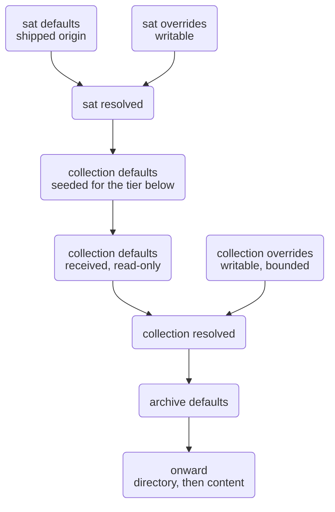

---
# Généré par le créateur de front matter SAT pour l'ingestion Eleventy. Ne pas éditer à la main.
# Les métadonnées canoniques vivent dans le sidecar de la ressource.
layout: layouts/document.njk
title: "Spécification de la cascade de configuration SAT"
description: "La cascade de configuration telle qu'elle se tient : forme du chemin, autorité, format de fichier, contenu des champs, et où s'exécute la résolution. Consolide et remplace six brouillons antérieurs."
lang: fr-CA
dir: ltr
date: 2026-09-09
author: Christopher Steel
rights: "AGPL-3.0-or-later"
version: 0.2.2
status: provisional
dc:
  title: ["Spécification de la cascade de configuration SAT"]
  creator: ["Christopher Steel"]
  subject: ["sat", "configuration", "cascade"]
  date: ["2026-09-09"]
  type: ["Text"]
  format: ["text/html"]
  identifier: ["urn:uuid:0a09106f-3f99-4494-a3fe-ccdb32d5dee5"]
  language: ["fr-CA"]
  rights: ["AGPL-3.0-or-later"]
sat:
  identifier: "urn:uuid:0a09106f-3f99-4494-a3fe-ccdb32d5dee5"
  isVersionOf: "urn:uuid:bf66e60e-9589-42d0-b999-7ae23c7ee34f"
  slug: "specification-de-la-cascade-de-configuration-sat"
---

# Spécification de la cascade de configuration SAT

## Objet

Ce document décrit la cascade de configuration de SAT telle qu'elle se tient, en un seul endroit, comme la conception à partir de laquelle `sat init` doit être construit.

Il consolide et remplace six brouillons : le modèle d'autorité, le parcours de vue d'ensemble de la hiérarchie de fichiers, les quatre brouillons de contenu de `config.yml`, et la note de détails de cascade. Là où ceux-ci étaient en désaccord, l'énoncé le plus récent est retenu, et tout désaccord restant est listé sous Conflits plutôt que résolu silencieusement.

## Marqueurs de provenance

`[D]` décidé, porté depuis un document source. `[I]` inféré d'une décision déjà prise, ayant besoin de confirmation plutôt que d'argumentation. `[P]` proposé, pas encore décidé. `[C]` porté depuis un document remplacé, non contredit par rien de plus récent, et méritant d'être confirmé.

## Vocabulaire

`[D]` **Nœud.** Un répertoire ou un fichier que SAT décrit. Un nœud porte un sidecar, tient un ou plusieurs rôles du vocabulaire des rôles, et prend ses défauts du nœud au-dessus de lui. Un nœud sans rien au-dessus est l'origine de la cascade, et ses défauts sont donnés plutôt que reçus.

`[D]` **Répertoire organisateur.** Un répertoire qui ne porte aucun sidecar et donc aucune configuration ni métadonnée propre. Ce n'est pas un nœud, il ne tient aucun rôle, et la cascade le traverse comme s'il n'était pas là. Son contenu appartient au nœud le plus proche au-dessus de lui, qui est ce qui le décrit et le possède. `bin/` et `lib/` à l'intérieur d'une instance SAT sont des répertoires organisateurs : la racine de l'instance SAT les décrit et fixe leur propriété et leurs permissions. Ils n'exigent aucune métadonnée ni configuration propre.

`[D]` **Racine.** Le nœud sommital d'un arbre ou d'un sous-arbre. La racine de l'instance est l'origine de la cascade : le seul nœud dont le `defaults/` est expédié plutôt que reçu. Une racine de collection est le nœud sommital d'une collection — une racine de son propre sous-arbre, mais recevant quand même ses défauts du nœud au-dessus d'elle.

`[D]` **Nom de nœud.** Le nom du nœud tel qu'il apparaît sur le disque. Pour un nœud de répertoire, le nom du répertoire. Pour un nœud de fichier, le nom du fichier incluant son extension, parce que le sidecar en tire son nom et que deux fichiers ne différant que par l'extension se résoudraient autrement à un seul nom de sidecar. Si deux tels fichiers sont liés, et comment, est une question de métadonnées à laquelle répond le modèle de relation plutôt que leurs noms.

`[D]` **Rôle.** `sat`, `collection`, `archive`, `directory` et `content` sont les cinq rôles possibles. Le type d'un nœud est son rôle, ou la liste des rôles qu'il tient. Le vocabulaire des rôles est déclaré une fois à la racine de l'instance et utilisé sur les deux axes de rôle.

`[D]` **Sidecar.** `.{nom du nœud}.assets/`, tenant tout le matériel propre à SAT pour ce nœud.

`[D]` **Auteur.** Le rôle rédacteur qui possède et écrit un corps de matériel. Le premier segment à l'intérieur d'un sidecar.

`[D]` **Sujet.** Le rôle auquel un corps de matériel est adressé. Toujours le rôle propre de l'auteur ou un en dessous.

`[D]` **État.** L'un de `defaults/`, `overrides/`, `resolved/`.

`[D]` **`"<notset>"`.** La chaîne littérale écrite comme `value` d'un champ quand aucune valeur n'a été déclarée. Elle rend visible un champ non déclaré lors du débogage d'une cascade, et c'est ce qui fait que `sat init` invite à décider dans certains cas. Un champ qui la porte n'a rien pour qu'un palier inférieur le perde.

`[D]` **Instance.** Une installation unique de SAT. Son nœud racine et tout ce que SAT expédie en dessous : `bin/`, `lib/`, et les archives de langue propres à SAT portant `locale/` et `docs/`. Tout cela est rédigé par le rôle `sat`, possédé par le groupe sat, et versionné avec le logiciel. Une instance tient le logiciel et la documentation propre à SAT dans les langues disponibles ; elle ne tient pas le matériel d'un archiviste, bien qu'elle soit ce qui le crée et le gère. L'instance active est résolue depuis l'exécutable en cours d'exécution plutôt que depuis un pointeur enregistré — voir *Localiser l'instance active*.

`[D]` **Collection.** Un corps d'archives et de matériel d'archiviste, et le répertoire dans lequel SAT le gère.

`[D]` **Archive.** Une portée de langue à l'intérieur d'une collection, tenant le rôle `archive`. Un site multilingue est une collection contenant une archive par langue. La langue est le seul axe qui forme des archives — voir *Axes et la limite de l'archive*.

`[D]` **Œuvre (Work).** Le contenu abstrait qu'un ensemble d'expressions réalise, indépendant de la langue et de tout autre axe. Une œuvre est identifiée par un `urn:uuid` et n'a pas de nœud propre : elle existe comme la valeur vers laquelle pointent les nœuds de contenu, et l'index des œuvres est sa matérialisation.

`[D]` **Expression.** Une réalisation d'une œuvre à un ensemble de coordonnées d'axe. Un nœud de contenu est une expression. Deux nœuds de contenu sont des expressions d'une même œuvre quand ils portent le même `isVersionOf`.

`[D]` **Axe.** Une dimension selon laquelle les expressions d'une œuvre varient : langue, registre, modalité. Un axe est *cantonné à l'archive* si ses valeurs partitionnent la collection en archives, ou *cantonné à la ressource* si ses valeurs sont enregistrées sur la ressource. La langue est le seul axe cantonné à l'archive.

## Axes et la limite de l'archive

`[D]` La langue est le seul axe qui forme des archives. Un répertoire d'archive est nommé pour une langue et tient le rôle `archive` ; aucun autre axe n'apparaît jamais comme un répertoire en dessous de la collection. `content/en-ca/` est une archive. `content/en-ca__easy/` n'en est pas une, et un résolveur qui la rencontre devrait signaler une archive non déclarée plutôt que d'inventer un axe.

`[D]` Tout autre axe est enregistré sur la ressource, dans ses propres métadonnées, et jamais dans un chemin. Deux expressions d'une œuvre différant seulement par le registre se trouvent dans le même répertoire de la même archive :

```text
en-ca/areas/legal/privacy/privacy-in-quebec.md
en-ca/areas/legal/privacy/privacy-in-quebec-easy.md
```

Les deux sont des nœuds de contenu portant le même `isVersionOf` et un `register` différent. Les répertoires entre l'archive et la ressource sont une organisation de sujets : ils disent de quoi traite un document, pas quelles coordonnées il détient.

`[D]` La raison pour laquelle les deux ne sont pas symétriques est que la langue est le seul axe auquel un arbre entier peut être cantonné sans mentir. Cantonner un axe à une archive affirme que tout en dessous partage cette valeur, et cette affirmation tient pour la langue — `en-ca/` est anglais de bout en bout — là où pour le registre elle ne tiendrait pas : un répertoire de documents en registre standard acquiert une sœur en lecture facile au moment où on en écrit une, et l'arbre devrait être restructuré pour la contenir. Cantonner à la ressource coûte un champ de métadonnée et ne restructure jamais rien.

`[I]` Une valeur d'axe cantonnée à la ressource peut être reflétée dans le nom du nœud comme un suffixe — `-easy` — de sorte que les variantes se trient ensemble dans un listage. C'est une convention de rédaction et cela ne porte aucune autorité. Les métadonnées sont ce que SAT lit ; un résolveur peut vérifier les deux l'un contre l'autre et signaler un désaccord, mais il n'extrait jamais la coordonnée du nom par analyse. Les noms sont pour les humains, et un nom en désaccord avec les métadonnées deviendrait autrement une seconde source de vérité.

`[P]` Si cette vérification croisée est un avertissement ou une erreur n'est pas réglé. Listé sous Questions ouvertes.

## Exemples de nœuds

La racine de l'instance SAT est un nœud tenant les rôles dont les défauts sont expédiés avec SAT.

Une collection est un nœud tenant le rôle `collection`. Ses défauts arrivent à travers la limite de rôle. Une collection à l'intérieur d'une autre collection est la même chose, prenant ses défauts de la collection au-dessus d'elle.

Une archive, un répertoire et un fichier de contenu sont des nœuds tenant les rôles `archive`, `directory` et `content`, prenant leurs défauts des nœuds au-dessus d'eux à travers les cascades de configuration et de métadonnées.

Une racine de collection peut se trouver n'importe où sur le système de fichiers. Elle est possédée par l'utilisateur, ne tient aucun logiciel par défaut, et porte les défauts qu'elle a reçus, ce qui est ce qui la rend portable : elle peut être déplacée vers un autre répertoire ou une autre machine et se résout contre quelque instance SAT qu'elle y trouve. Une collection déplacée appartient à l'instance contre laquelle elle se résout actuellement, qui n'a pas besoin d'être celle qui l'a créée.

Tout fichier ou répertoire sans sidecar n'est pas un nœud, ce qui est ce qui garde les répertoires organisateurs et les fichiers ignorés entièrement hors de la cascade.

## Forme du chemin

`[D]` Les fichiers de configuration portent deux axes de rôle.

```bash
.{level}.assets/{author}/config/{subject}/{state}/config.yml
```

`{level}` est le **nom** complet d'un répertoire ou d'un fichier incluant son extension. `{author}` et `{subject}` sont des **rôles**. Ils ont l'air de la même sorte de chose à la racine de l'instance seulement parce que ce répertoire se trouve être nommé `sat`. À une archive nommée `en-ca`, le level est `en-ca` et l'author est `archive`.

| Segment | Signification | Tiré de |
| --- | --- | --- |
| `{level}` | Le nom du nœud auquel appartient le sidecar : un nom de répertoire, ou un nom de fichier avec son extension | Le système de fichiers |
| `{author}` | Le rôle qui possède et écrit ce matériel | Le vocabulaire des rôles |
| `{subject}` | Le rôle auquel le matériel est adressé | Le vocabulaire des rôles |
| `{state}` | `defaults/`, `overrides/` ou `resolved/` | Ensemble fixe de trois |

`[P]` Renommer `{level}` en `{node}`. Le vocabulaire définit déjà *nom de nœud* comme exactement ce que ce segment contient, et *level* est un reliquat des brouillons de parcours, où il décrivait un échelon de la cascade plutôt qu'un nom sur le disque. Garder les deux mots pour une seule chose coûte à un lecteur une étape de traduction à chaque chemin. Listé sous Questions ouvertes ; `{level}` est retenu tout au long de ce document jusqu'à ce que la question soit tranchée, de sorte que le renommage atterrisse en une seule passe plutôt qu'à moitié.

Exemples travaillés :

| Chemin | Level | Author | Subject |
| --- | --- | --- | --- |
| `sat/.sat.assets/sat/config/collection/defaults/config.yml` | `sat`, le répertoire racine | `sat` | `collection` |
| `en-ca/.en-ca.assets/archive/config/directory/overrides/config.yml` | `en-ca`, un nœud de répertoire tenant le rôle archive | `archive` | `directory` |
| `.report.md.assets/content/config/content/resolved/config.yml` | `report.md`, un nœud de fichier | `content` | `content` |

Le troisième exemple montre l'axe du sujet à son plus étroit. Un nœud de contenu est une feuille, donc il ne peut s'adresser qu'à lui-même.

### Où se trouve un sidecar

Un sidecar se trouve dans le répertoire où se résout le nom de son nœud.

Pour un nœud de répertoire, cela signifie à l'intérieur de lui : `sat/.sat.assets/`.

Pour un nœud de fichier, qui ne peut pas contenir un répertoire, le sidecar se trouve à côté de lui dans le même répertoire parent : `docs/.report.md.assets/` aux côtés de `docs/report.md`.

Une conséquence en découle et vaut la peine d'être connue avant qu'elle ne morde. Un nœud de répertoire déplacé avec `mv` emporte son sidecar à l'intérieur de lui. Un nœud de fichier déplacé avec `mv` laisse son sidecar derrière lui, parce que le sidecar est une sœur plutôt qu'un enfant. Soit déplacer un nœud de contenu est une opération SAT plutôt qu'une opération de système de fichiers, soit l'asymétrie est acceptée et énoncée.

`[D]` Le segment auteur est la limite de propriété. Tout ce qui se trouve sous `.sat.assets/sat/` appartient au rôle `sat` et à rien d'autre : un seul `chgrp`, aucune exception à l'intérieur, et aucun autre rôle ne tenant un fichier inscriptible nulle part dans ce sous-arbre.

Avec un seul axe, les défauts sortants de sat et les propres éditions du rôle receveur partageraient un répertoire, et la propriété devrait être affirmée fichier par fichier plutôt que par sous-arbre.

### Un dossier d'auteur par rôle tenu

`[D]` Un nœud porte exactement un dossier d'auteur pour chaque rôle qu'il tient. Chaque nœud en dessous de la racine de l'instance tient un rôle et porte un dossier. Combien la racine de l'instance en porte n'est pas réglé — voir Conflits.

Amorcer un palier inférieur se produit sur l'axe du sujet, à l'intérieur du dossier d'auteur propre du nœud. Une collection amorce des archives à `.collection.assets/collection/config/archive/`. Un `.collection.assets/archive/` séparé affirmerait une limite de propriété pour un rôle qui n'existe pas à ce nœud.

`[D]` L'invariant : le dossier d'auteur d'un nœud est son rôle, et son rôle est son dossier d'auteur. Lisible depuis le seul sidecar, et `chgrp`-able en une seule opération.

### Troncation du sujet

`[D]` Un rôle peut s'adresser à lui-même et aux paliers en dessous de lui, jamais au-dessus. `collection/config/sat/` n'est pas un chemin que la disposition produit, donc la règle acyclique est appliquée par le système de fichiers plutôt que par convention.

`[D]` La troncation s'applique à l'axe du sujet seulement. L'axe de l'auteur ne se tronque pas ; c'est le rôle du nœud.

## Les trois états

`[D]` Chaque dossier de sujet porte trois répertoires d'état.

| Répertoire | Écrit par | Objet |
| --- | --- | --- |
| `defaults/` | le résolveur, depuis le level au-dessus | Le contrat que ce level a reçu. Persiste, parce qu'un sous-arbre n'est pas transportable sans lui. |
| `overrides/` | l'utilisateur | Deltas contre `defaults/`. Le seul fichier inscriptible de l'ensemble. |
| `resolved/` | le résolveur, localement | `defaults/` composé avec `overrides/`. Un cache régénérable. |

`[D]` `defaults/` et `resolved/` sont tous deux en lecture seule et ne sont pas le même genre d'artefact. `defaults/` est une entrée reçue et doit être préservé. `resolved/` est une sortie dérivée, sûre à supprimer, toujours reconstructible à partir des deux fichiers à côté d'elle, et un candidat raisonnable pour le gitignore.

`[D]` `resolved/` à un level et `defaults/` au suivant tiennent le même contenu. Les matérialiser aux deux bouts rend la cascade inspectable à chaque nœud sans exécuter de résolveur, et réduit la génération des défauts d'un enfant à une copie plutôt qu'à une fusion.

## D'où viennent les défauts

`[D]` À `config/sat/` et à chaque dossier de sujet en dessous, il n'y a pas de level au-dessus. `sat` est l'origine, donc `defaults/` y est la base expédiée avec SAT plutôt que quelque chose de reçu. Ce n'est qu'à partir du nœud de collection vers le bas que `defaults/` signifie reçu du level au-dessus.

## La limite entre l'instance et l'utilisateur

`[D]` Un déploiement SAT tient deux corps de configuration.

L'instance SAT elle-même est le nœud racine et tout ce que SAT expédie avec elle : `bin/`, `lib/`, et les archives de langue propres à SAT portant `locale/` et `docs/`. Tout cela est rédigé par le rôle `sat`, possédé par le groupe sat, et versionné avec le logiciel.

`[D]` La limite est positionnelle dans la cascade, pas sur le système de fichiers. Elle tombe au premier nœud tenant un rôle autre que `sat`, où que ce nœud se trouve. Les données utilisateur sont tout ce qui se trouve de ce nœud vers le bas.

`[D]` Une collection peut donc être placée où l'archiviste le veut — `~/projects/websites`, par exemple — et une collection qui se trouve à l'intérieur du répertoire de l'instance reste des données utilisateur. La position dans la cascade décide de la propriété ; l'emplacement sur le disque ne le fait pas.

`[D]` La remise est une seule paire de fichiers. La configuration SAT résolue pour le sujet `collection` devient les défauts reçus de la première collection. Les collections imbriquées en dessous de celle-ci reçoivent leurs défauts de la collection au-dessus d'elles, et ainsi de suite vers le bas.

```bash
.sat.assets/sat/config/collection/resolved/config.yml
        becomes
{collection}/.{collection}.assets/collection/config/collection/defaults/config.yml
```

Tout ce qui est au-dessus de cette première collection utilisateur est l'instance SAT : changer la configuration là change l'instance. Tout ce qui est en dessous appartient à l'archiviste, et changer la configuration là ne change que ses archives.

`[D]` Une collection non enracinée est une collection qui se trouve entièrement hors de l'arbre de répertoires de l'instance SAT — `~/websites/vishpala.com`, par exemple. Ce n'est pas un cas particulier ; elle se résout à travers la même cascade, contre quelque instance qui tourne.

## La cascade

### Description

La configuration entre à la racine de l'instance, où `sat` déclare à la fois sa propre configuration et un point de départ pour chaque palier en dessous. À chaque nœud, les défauts reçus et les redéfinitions locales se composent en une valeur résolue, et cette valeur résolue devient les défauts du nœud en dessous. La chaîne est linéaire : un fichier par état, une étape par level, et rien à réconcilier entre des branches.

### Diagramme



## Forme du fichier

`[D]` Chaque fichier dans chaque répertoire d'état utilise la même forme de champ que la cascade de métadonnées.

```yaml
field_name:
  value: <value>
  overridable: true|false
  status: available|planned|deprecated   # optional; defaults to available
```

`[D]` Un seul résolveur sert les deux arbres. Parce que les deux arbres partagent cette forme de champ et les mêmes trois répertoires d'état, la composition est la même opération dans les deux : lire `defaults/`, lire `overrides/`, appliquer les deltas permis, écrire `resolved/`. Seul le chemin diffère — la configuration porte deux axes de rôle et un dossier de sujet, les métadonnées portent un axe de rôle et un dossier d'espace de noms — donc la différence se limite à la façon dont le résolveur reçoit un fichier, pas à ce qu'il en fait. Il y a une implémentation, pas deux tenues synchronisées.

## Autorité

`[D]` Sat gagne toujours, et `overridable` est la façon dont sat délègue.

| Sat déclare | Effet en dessous |
| --- | --- |
| `value` fixée, `overridable: false` | La valeur de sat tient. Aucun palier en dessous ne peut la changer. |
| `value` fixée, `overridable: true` | Sat délègue. Le palier suivant peut remplacer la valeur. |
| `value: <notset>` | Rien à perdre. La valeur du palier suivant tient. |

`[D]` La même relation tient une étape plus bas entre collection et archive, et encore à chaque étape. L'autorité d'un palier est toujours un sous-ensemble de ce qu'il a reçu.

`[D]` `overridable` est monotone. `true` vers `false` est permis à n'importe quel level, `false` vers `true` jamais. La délégation rétrécit en descendant et ne peut pas s'élargir, ce qui est ce qui rend « sat gagne toujours » vrai au sens fort : sat décide s'il gagne, et aucun palier en dessous ne peut rouvrir un champ que sat a fermé.

### Pourquoi il n'y a pas de règle d'ordonnancement

`[D]` Un brouillon antérieur proposait de départager par ordre de pile. Aucune règle de ce genre n'est nécessaire, parce qu'aucune égalité ne se produit.

La configuration de sat pour `archive` se trouve à la racine. La configuration de collection pour `archive` se trouve au nœud de la collection. Ce sont des stations consécutives sur une chaîne menant au maillon suivant, pas des fichiers concurrents adressés au même lecteur.

`[D]` Aucun champ de préséance n'est requis. La préséance se résout champ par champ, déterminée par `overridable` plutôt que par un fichier qui l'emporte sur un autre en bloc.

## Amorçage et résolution

`[D]` Deux opérations agissent sur ces fichiers, et ce ne sont pas la même chose.

**L'amorçage (seeding)** écrit `overrides/config.yml`. Il s'exécute à `role init`. Il prend les champs reçus dans `defaults/` qui portent `overridable: true` et les écrit dans `overrides/` avec leurs valeurs reçues, prêts à être édités. Les champs portant `overridable: false` ne sont pas écrits du tout, de sorte qu'un champ verrouillé n'est jamais présenté à un utilisateur plutôt que d'être refusé après coup. Des défauts sensés peuvent être expédiés pour un rôle, et le fichier peut également être édité à la main par la suite par les utilisateurs du rôle.

**La résolution** écrit `resolved/config.yml`. Elle lit `defaults/` et `overrides/` et produit la valeur reçue pour chaque champ, remplacée par la valeur de la redéfinition partout où elle diffère. Elle s'exécute chaque fois qu'une commande touche des valeurs mises en cascade. Elle ne se soucie pas de savoir si quoi que ce soit a été édité : sans édition, `resolved/` est égal à `defaults/`.

`[D]` La distinction compte parce que les deux s'exécutent à des moments différents et répondent à des personnes différentes. L'amorçage présente des choix, une fois. La résolution les applique, à répétition.

`[I]` Deux conséquences suivent pour tout ce qui est ajouté à la main à `overrides/`. Un champ absent de `defaults/` en tant que substituable est ignoré à la résolution, cohérent avec le fait que les écritures invalides sont ignorées pour l'instant. Une clé `status` est ignorée, parce que `status` rapporte ce que le logiciel prend en charge et n'est pas à un palier de le déclarer.

### Rendre les champs verrouillés lisibles

`[P]` Un utilisateur qui ne peut pas voir un champ verrouillé ne peut pas dire s'il est absent, non pris en charge, ou retenu au-dessus de lui, et ne peut pas dire à qui demander. C'est un coût réel de la règle d'amorçage, et cela mérite une réponse — mais pas en écrivant des champs non inscriptibles dans le seul fichier inscriptible, ce qui ferait de `overrides/` un mélange de ce qui peut être changé et de ce qui ne peut pas l'être, et inviterait des éditions que la résolution rejetterait ensuite silencieusement.

`[P]` Y répondre dans `resolved/` à la place, qui liste déjà chaque champ. Enregistrer sur chaque champ verrouillé le rôle qui l'a fermé — le palier où `overridable` est passé pour la dernière fois de `true` à `false`. La monotonie fait de cela une seule réponse non ambiguë plutôt qu'une chaîne à parcourir. Deux choses en découlent dont un utilisateur a réellement besoin : quels champs sont retenus, et quelle autorité solliciter.

`[P]` Une commande de rapport sur les mêmes données (`sat config --locked`, ou l'équivalent du rôle) couvre le besoin de découvrabilité sans changement de schéma, puisque la provenance est dérivable de la cascade que le résolveur a déjà parcourue.

## `status`

`[D]` `status` décrit le champ lui-même : si SAT le prend en charge, et si cette prise en charge arrive ou part.

| Clé | Question |
| --- | --- |
| `value` | À quoi est-ce fixé ? |
| `overridable` | Un palier inférieur peut-il le changer ? |
| `status` | SAT prend-il en charge ce champ, et pour combien de temps ? |

Sans elle, `overridable: false` signifie deux choses incompatibles — structurellement fixé, et pas encore pris en charge — et un lecteur ne peut pas les distinguer.

| Valeur | Signification |
| --- | --- |
| `available` | Pris en charge et en usage normal. Le défaut quand `status` est absent. |
| `planned` | Le champ existe et est déclaré, mais SAT ne prend pas encore en charge sa variation. Une valeur légale aujourd'hui. |
| `deprecated` | Toujours honoré, mais prévu pour retrait. Les valeurs fixées continuent de se résoudre. |

`[D]` La prise en charge qui arrive devient un changement de valeur plutôt qu'un changement de schéma. `sat init` saute les champs `planned`, les erreurs peuvent dire pas encore pris en charge plutôt que verrouillé, `status: planned` est repérable par recherche comme feuille de route, et `deprecated` donne aux archives une fenêtre d'avertissement.

`[D]` `status` descend avec `value` et `overridable`. Il est déclaré par SAT et n'est pas éditable par l'utilisateur, parce qu'il rapporte ce que le logiciel prend en charge, ce qui n'est pas une chose sur laquelle un palier inférieur a une opinion.

`[D]` `experimental` est délibérément exclu. Le vocabulaire est plus facile à étendre qu'à rétrécir.

## Les collections peuvent contenir des collections

`[D]` `collection` se liste elle-même dans `children`, donc une collection peut tenir d'autres collections aussi bien que des archives. C'est le second rôle auto-référençant après `directory`, et `sat init` qui récurse sur `children` le gère sans nouvelle règle.

Voici à quoi ressemble sur le disque la propre organisation d'un archiviste :

```text
websites/                  a collection: shared licence, publisher, theme
  vishpala.com/            a collection: one site
    en-ca/                 an archive: one language
    fr-ca/                 an archive: one language
  example.org/             a collection: another site
    en-ca/
```

`websites/` est une collection et porte un sidecar, donc une licence ou un éditeur déclaré là une fois se met en cascade vers chaque site en dessous — à moins que la collection propre d'un site ne le redéfinisse — plutôt que d'être reformulé dans chaque sous-collection ou archive.

`[D]` Les collections d'exemples que SAT expédie sont une collection de collections exactement en ce sens. Elles tiennent le rôle `collection`, portent un sidecar, et transmettent leurs défauts aux collections ou archives en dessous d'elles. Ce sont des exemples de données utilisateur, pas une partie de l'instance SAT, donc tout ce qui est déclaré sur elles s'applique aux exemples seuls.

`[D]` Pour la clarté, les collections d'exemples sont placées hors du répertoire de l'instance SAT — à `~/projects/websites` sur les systèmes nix, et l'équivalent ailleurs. Les placer hors de l'instance montre à un archiviste où vivent les collections et archives gérées, et rend la séparation visible plutôt que simplement énoncée.

`[D]` C'est aussi la forme du Super SAT, atteinte par le rôle qui était déjà récursif plutôt que par l'imbrication d'instances. L'absence de `sat` de chaque liste `children` est délibérée et n'est pas un oubli à corriger plus tard.

`[D]` L'index des œuvres est cantonné à la racine de collection la plus proche, pas la plus extérieure. Une œuvre appartient à vishpala.com plutôt qu'à websites.

## Les instances imbriquées sont hors de portée

`[D]` Une instance SAT ne contient pas une autre instance SAT dans cette version. L'imbrication est une préoccupation de Super SAT, et la configuration de Super SAT est reportée.

## Répertoires organisateurs

`[D]` Un répertoire sans sidecar est un répertoire organisateur. Les nœuds portent `.{name}.assets/` et les répertoires organisateurs n'en portent pas, donc aucune liste de noms réservés n'est nécessaire et rien n'exige de traduction.

`[D]` Un répertoire organisateur ne tient aucune configuration et aucune métadonnée propre. Son contenu appartient au nœud le plus proche au-dessus de lui, qui le décrit et fixe sa propriété et ses permissions.

`[D]` `bin/` et `lib/` à l'intérieur d'une instance SAT sont des répertoires organisateurs. Ils organisent les exécutables et bibliothèques de l'instance, la racine de l'instance les décrit, et ils ne portent aucun sidecar.

`[D]` Le nom d'un répertoire organisateur ne porte aucun sens pour SAT, donc il peut varier avec `interface_language` et peut être renommé ou traduit sans conséquence.

## Ce que SAT ignore

`[D]` SAT ignore le bruit du système de fichiers. `.DS_Store`, `Thumbs.db`, les fichiers temporaires d'éditeur, et `.git` et son contenu ne sont jamais des nœuds de contenu candidats.

`[P]` Porter la liste d'exclusion comme un champ de configuration mis en cascade plutôt que comme un fichier séparé. Un champ `ignore` avec `overridable: true` réutilise la machinerie qui existe déjà, hérite sensément, et est visible dans `resolved/` aux côtés de tout le reste. Un fichier `.satignore` serait plus familier à quiconque a rencontré `.gitignore`, mais il introduit un second mécanisme de configuration avec ses propres règles de préséance, se tenant hors de la cascade que ce document existe pour décrire.

```yaml
ignore:
  value: [".DS_Store", "Thumbs.db", ".git"]
  overridable: true
  status: planned
```

`[P]` `ignore` est le premier champ à valeur de liste où le remplacement est le mauvais défaut. Un répertoire qui veut ignorer un motif de plus ne devrait pas avoir à reformuler la liste héritée pour la garder. `overridable` répond à *cela peut-il changer*, pas *comment* — donc une seconde clé est nécessaire plutôt qu'un second sens pour la première :

```yaml
ignore:
  value: [".DS_Store", "Thumbs.db", ".git"]
  overridable: true
  merge: append          # append | replace ; defaults to replace
```

`merge: replace` garde chaque champ se comportant comme aujourd'hui, donc rien de déjà décidé ne change. `merge: append` dit que la valeur d'un palier inférieur est ajoutée à ce qu'il a reçu plutôt que de s'y substituer. Si `append` a aussi besoin d'un moyen de retirer une entrée héritée est une question pour le champ qui en a besoin en premier, pas pour celui-ci.

`[P]` Si un `.satignore` est aussi voulu — pour des motifs par répertoire qu'un archiviste peut écrire sans toucher à la configuration — il devrait être défini comme contribuant au champ `ignore` plutôt que comme une source indépendante, de sorte qu'il reste une seule réponse résolue par nœud.

## Localiser l'instance active

`[D]` Une collection peut se trouver n'importe où sur le système de fichiers, donc la cascade ne peut pas compter sur le fait de remonter l'arbre de répertoires pour trouver l'instance à laquelle elle appartient.

`[D]` SAT est vendorisé. L'exécutable vit à l'intérieur de l'instance à `bin/`, donc l'instance est le répertoire parent de l'exécutable. Rien n'est stocké dans la collection pointant en retour vers une instance : aucun registre à garder synchronisé, aucun pointeur à réparer.

| Situation | Résultat |
| --- | --- |
| La collection reste en place | La même instance se résout |
| SAT mis à niveau sur place | La nouvelle version se résout |
| Collection déplacée vers une autre machine | L'instance de cette machine se résout |

`[D]` Un seul exécutable va sur le PATH : un unique répartiteur `sat` acheminant vers les exécutables de rôle en dessous de `bin/`, plutôt que cinq binaires en concurrence pour le même nom.

`[D]` Résoudre l'instance depuis l'**exécutable en cours d'exécution**, pas depuis une recherche sur le PATH. `which sat` répond à ce que le shell exécuterait, pas à ce qui est en cours d'exécution, donc une invocation directe par chemin, ou une exécution sous cron ou systemd avec un PATH différent, peut silencieusement résoudre une instance différente de celle en cours d'exécution. `/proc/self/exe` sur Linux, avec `$0` à travers `realpath` comme filet de sécurité portable, répond à la question réellement posée. Cela clôt aussi la question des instances multiples plutôt que de la reporter : invoquer une instance spécifique par chemin devient la dérogation, ce qui est ce qui rend plusieurs instances utilisables côte à côte pendant le développement.

`[D]` Dans les deux cas, le chemin est passé à travers `realpath` avant le dépouillement, puisque les entrées de PATH sont couramment des liens symboliques.

## Ce qui appartient où

`[D]` Trois sortes de champ apparaissent dans ces fichiers.

| Sorte | Exemple | Comportement |
| --- | --- | --- |
| Vocabulaire | `roles` | Déclaré une fois à `sat`, jamais substituable. Nomme les rôles que toute l'instance utilise. |
| Structurel | `children` | Décrit la forme d'un palier. Verrouillé, parce qu'un palier ne redéfinit pas ce qu'il peut contenir. |
| Comportemental | `default_metadata`, `interface_language` | En cascade par conception. Délégué vers le bas sauf verrouillage. |

`[D]` Seule la troisième sorte utilise `overridable` de façon significative. Les deux premières sont `false` par construction.

## Contenu des champs

### `config/sat/defaults/config.yml`

```yaml
roles:
  value: [sat, collection, archive, directory, content]
  overridable: false

sat_version:
  value: "<notset>"
  overridable: false

children:
  value: [collection, archive, directory, content]
  overridable: false

default_metadata:
  value: "dc-1.1"
  overridable: false
  status: planned

interface_language:
  value: "en-ca"
  overridable: false
  status: planned
```

`[D]` `roles` et `children` sont tous deux pleinement peuplés ici, pour deux raisons différentes qui valent la peine d'être tenues séparées.

`roles` est le vocabulaire : les cinq rôles que cette instance utilise n'importe où, sur l'un ou l'autre axe. C'est cinq parce que SAT en définit cinq.

`children` est structurel : quels rôles peuvent se trouver directement en dessous d'un nœud `sat`. C'est quatre parce que `sat` est exclu — les instances ne s'imbriquent pas — et parce que la racine de l'instance est réellement le parent de plus d'une sorte d'enfant. Les propres archives de langue de SAT se trouvent directement en dessous d'elle comme des nœuds `archive`, sans collection intermédiaire.

`[P]` Si `directory` et `content` appartiennent au `children` de `sat` est moins réglé que `collection` et `archive`, qui ont des occupants connus. Listé sous Questions ouvertes.

`[D]` `roles` porte tout le vocabulaire des rôles. Un brouillon antérieur déclarait aussi `tiers` avec la même valeur, distingué comme vocabulaire contre structure. Les deux étaient utilisés de façon interchangeable et sont effondrés ici en `roles`. Si un cas survient où l'ordonnancement et l'appartenance diffèrent réellement, il sera traité alors.

`[D]` `sat_version` enregistre la version de SAT qui a créé l'instance, de sorte qu'une migration ait quelque chose à lire. `sat init` l'écrit, ce qui est pourquoi la base expédiée porte `<notset>`.

`[D]` `default_metadata` et `interface_language` sont comportementaux par conception et verrouillés aujourd'hui seulement parce que SAT prend en charge exactement une norme de métadonnées et une langue d'interface. Il n'y a rien à déléguer. `status: planned` enregistre que cela reflète l'état du logiciel plutôt que la nature des champs.

### `roles` en dessous de la racine

`[P]` Seule la racine est empilée. Partout en territoire utilisateur, un nœud tient exactement un rôle, donc `roles` à ce nœud reformulerait le nom du dossier d'auteur et ne porterait aucune information. Chaque nœud en dessous de la racine dériverait plutôt son rôle de son dossier d'auteur.

`[P]` Cela vaut la peine d'être testé avant d'être adopté, parce que cela fait du vocabulaire des rôles le seul champ en cascade qui cesse de se mettre en cascade, et un résolveur qui doit traiter comme un cas particulier l'absence d'un champ fait plus de travail qu'un résolveur qui le lit où qu'il se trouve. L'économie est une ligne dupliquée par nœud ; le coût est une exception à une règle qui n'en a autrement aucune. Listé sous Questions ouvertes.

### Les sujets restants

| Sujet | `children` |
| --- | --- |
| `collection` | `[collection, archive]` |
| `archive` | `[directory]` |
| `directory` | `[directory, content]` |
| `content` | `[]` |

`[D]` `collection` et `directory` se listent tous deux eux-mêmes, permettant l'imbrication à ces deux levels. `content` ne liste rien, ce qui en fait une feuille.

`[D]` `default_metadata` et `interface_language` ne sont pas reformulés dans ces fichiers de sujet. Ils ne sont pas absents de la configuration d'un nœud inférieur — la mise en cascade signifie l'inverse, et `resolved/` à un level devient `defaults/` au suivant intégralement — ils ne sont simplement pas redéclarés, parce qu'un champ qui est délégué vers le bas est déclaré une fois à son origine et porté, pas répété à chaque station.

## Conventions de nommage

`[D]` Aucun préfixe de rôle, parce que le chemin cantonne déjà le champ. `snake_case`, à l'image de `default_metadata`. Des noms plutôt que des questions, de sorte que la valeur réponde à la clé.

## Où s'exécute la résolution

`[D]` La résolution est une bibliothèque, pas une commande. Il n'y a pas de `sat resolve`.

Elle est appelée pendant `sat init` et l'équivalent d'init de chaque palier, et par toute opération CRUD qui lit ou écrit des valeurs mises en cascade.

`[D]` La commande de chaque rôle exécute une vérification de cascade à travers les paliers en dessous d'elle avant d'agir, dans la même forme en escalier que la cascade elle-même. Une commande au level racine vérifie tout l'arbre ; une commande au level répertoire ne vérifie que ce qui se trouve en dessous de ce répertoire.

`[D]` Aucun observateur de système de fichiers n'est requis et la péremption n'a jamais besoin d'être détectée, parce qu'aucune commande ne lit `resolved/` sans d'abord le reconstruire. L'échange est le coût : une commande à la racine fait le travail de tout l'arbre.

## `sat init`

`[D]` `sat init` invite à décider pour chaque champ dont la `value` est `<notset>`, et pour rien d'autre. Deux choses se tiennent aux côtés de cette règle plutôt que de la contredire.

`[D]` L'amorçage s'exécute à l'init et écrit les champs substituables dans `overrides/` avec leurs valeurs reçues. L'init montre donc à l'utilisateur la configuration dont il hérite et lui donne le fichier dans lequel la changer. Présenter les défauts n'est pas une seconde passe d'invitation à décider ; c'est ce que l'amorçage fait déjà, rendu visible.

`[D]` `sat_version` est écrit plutôt que demandé. Il porte `<notset>` dans la base expédiée parce que SAT le remplit à l'init, et c'est la seule exception à la règle d'inviter-à-décider-sur-`<notset>`.

`[C]` Les défauts racine de la cascade de métadonnées sont expédiés avec chaque champ à `<notset>`, donc l'init invite à décider pour tous. Les défauts racine de l'arbre de config sont expédiés peuplés, donc c'est surtout silencieux pendant l'init.

`[D]` `sat init` saute les champs portant `status: planned`, parce qu'il n'y a rien à demander à propos d'un champ à une seule valeur légale.

`[D]` Un champ qui porte encore `<notset>` après l'init déclenche une notification, et une invite à décider là où la situation en appelle une. Ce n'est pas silencieusement accepté comme une valeur résolue. C'est ce qui rend la sentinelle utile à un développeur autant qu'à un utilisateur : un champ non déclaré reste visible plutôt que de disparaître dans la cascade.

`[C]` `sat init` lit le `children` de chaque nœud pour décider dans quoi descendre, plutôt que de porter une forme fixe à cinq paliers qui lui serait propre. Parce que `collection` et `directory` se listent eux-mêmes, un nœud de l'un ou l'autre genre peut se répéter un nombre quelconque de fois avant que l'arbre ne touche le fond — et cette répétition n'a besoin d'aucune règle dans la commande, puisque suivre `children` est déjà la règle. Les paliers auto-référençants sont de la configuration, pas un cas particulier dans le code.

`[D]` `sat init` descend à travers tout répertoire défini par SAT pour lequel il ne trouve aucun sidecar, ce qui est la façon dont les répertoires organisateurs sont traversés. Il ne descend pas hors de l'arbre qui lui a été donné.

## La cascade de métadonnées

`[D]` La cascade de métadonnées utilise les mêmes trois états et les mêmes règles d'autorité, avec un axe de rôle plutôt que deux.

```
.{level}.assets/{role}/metadata/dc/{state}/dc.yml
```

La configuration a besoin des deux axes parce qu'un palier déclare une structure à propos d'autres paliers. Les métadonnées ne le font jamais : un rôle écrit des valeurs DC pour le nœud auquel elles s'appliquent, donc l'auteur et le sujet sont le même rôle et le second axe serait toujours un dossier d'un seul.

`[D]` La cascade de métadonnées prend aussi `status`. Les deux arbres sont conçus comme des jumeaux, et des raffinements DCTERMS arrivant plus tard est exactement le cas que `planned` décrit.

`[D]` Le répertoire d'état se trouve en dessous d'une couche d'espace de noms dans l'arbre de métadonnées, `metadata/dc/`, laissant de la place pour `metadata/dcterms/` à côté plus tard. La configuration n'a pas de couche d'espace de noms, donc `config/` se trouve directement au-dessus de ses dossiers de sujet.

`[D]` `metadata/sat/` est le second espace de noms et est présent aujourd'hui. Il tient les termes dont SAT a besoin et pour lesquels DC 1.1 n'a pas de mot, et c'est là que vivent `identifier`, `isVersionOf`, `slug` et les valeurs d'axe cantonnées à la ressource. La règle de parité des noms s'applique : là où DCTERMS a un terme correspondant, la propriété `sat` prend son nom local, et SAT ne forge un terme que pour ce que DCTERMS ne peut pas dire.

```
.{level}.assets/{role}/metadata/sat/{state}/sat.yml
```

`[D]` `isVersionOf` à un nœud de contenu porte le `urn:uuid` de l'œuvre ; `identifier` porte celui propre à l'expression. Les deux sont minés avec `uuidgen -r` et aucun n'est dérivé d'un nom, d'un chemin, ou d'un contenu — un identifiant dérivé change quand la chose qu'il nomme est renommée, ce qui est précisément l'événement qu'un identifiant existe pour survivre.

## Version de YAML

`[D]` Les fichiers SAT sont analysés comme YAML 1.2. C'est une exigence de correction plutôt qu'une préférence.

YAML 1.1 traite `no`, `y`, `on` et `off` comme des booléens. `no` est le code ISO 639-1 du norvégien, donc sous un analyseur 1.1, une clé de langue norvégienne devient `false` — silencieusement, sans erreur, et invisible à l'inspection. Un slug numérique nu devient un entier et cesse de correspondre à la chaîne qu'il nomme. Pour un système dont les archives sont indexées par code de langue, c'est porteur de charge plutôt que pédant.

`[D]` Trois défenses indépendantes, dont aucune ne coûte rien : mettre entre guillemets les clés de langue et les slugs dans chaque fichier SAT ; analyser avec une implémentation YAML 1.2 ; et faire en sorte que la validation vérifie que les clés et les slugs sont des chaînes.

`[I]` Les implémentations diffèrent dans leur défaut. Le `yaml` de Node et `js-yaml` v4 sont en 1.2 par défaut et sûrs. PyYAML est seulement en 1.1 et ne l'est pas ; `ruamel.yaml` en mode 1.2 est l'équivalent Python.

## Conflits à trancher

**La langue du contenu dans la configuration.** *Tranché en 0.2.2.* La langue du contenu est le `language` de DC 1.1. Elle appartient à `metadata/dc/`, jamais à la configuration, et `interface_language` couvre le sens propre à l'opérateur. Le `sat-language` de la note de détails de cascade n'est pas réinstauré.

Définir une archive comme une portée de langue règle cela. Le nom du nœud de l'archive est la langue, donc un champ de configuration serait un second énoncé du même fait sans rien pour garder les deux synchronisés. La valeur est déclarée une fois au nœud de l'archive, dans `metadata/dc/`, et verrouillée là ; chaque nœud de contenu en dessous reçoit la langue à travers la cascade de métadonnées plutôt que de la reformuler.

**Combien de dossiers d'auteur la racine de l'instance porte.** Deux énoncés décidés sont en désaccord.

*Cinq.* La racine est le nœud empilé et tient les cinq rôles ; un nœud porte un dossier d'auteur par rôle tenu ; donc cinq. C'est ce que disent les brouillons antérieurs.

*Un.* La configuration sortante pour un palier inférieur emprunte l'axe du sujet à l'intérieur du dossier propre de l'auteur — `.sat.assets/sat/config/collection/` est la façon dont sat amorce les collections. Sous cette règle, rien n'est jamais écrit dans `.sat.assets/collection/`, parce que le premier nœud de collection réel tient son propre dossier d'auteur `collection/` et y reçoit ses défauts. Et la 0.1.9 a décidé que la limite de l'instance tombe au premier nœud non-`sat`, ce qui dit que la racine n'est pas elle-même une collection.

Les deux règles ont été réglées séparément et n'ont pas été tenues l'une contre l'autre. Si la racine tient un seul dossier, *racine empilée* signifie qu'elle rédige pour cinq sujets plutôt qu'elle tient cinq rôles, et le vocabulaire devrait le dire.

## Re-résolution contre une instance différente

`[D]` Une collection migrée reçoit les règles de la nouvelle instance à travers la cascade de config, de la même façon que tout nœud les reçoit. Il n'y a pas de chemin de migration séparé.

Une collection peut néanmoins arriver en tenant une redéfinition pour un champ que la nouvelle instance verrouille. Rien n'a été violé, puisque `overridable` ne s'est jamais élargi, mais la redéfinition en est maintenant une que la collection ne peut pas garder.

`[P]` Proposé, au nom de l'archiviste. Garder la redéfinition où elle est, dans `overrides/`, et la marquer inerte dans `resolved/`. La valeur de la nouvelle instance se résout et l'archive se comporte correctement sous ses nouvelles règles, tandis que l'intention énoncée de l'archiviste survit dans le fichier plutôt que d'être supprimée par un outil. Le rapporter clairement : quels champs sont retenus mais non honorés, et quelle instance les a verrouillés.

Les alternatives sont pires de façons spécifiques. Laisser tomber la redéfinition détruit silencieusement un travail qu'un archiviste a fait délibérément, et le fait pendant une migration, ce qui est exactement le moment où personne ne lit attentivement. Refuser de résoudre bloque entièrement la migration à cause d'un champ qui n'a peut-être pas d'importance, et laisse la collection inutilisable jusqu'à ce que quelqu'un édite un fichier à la main pour faire avancer un outil.

`[P]` Si la redéfinition est plus tard à nouveau permise — parce que la collection retourne à une instance plus permissive, ou que le champ est déverrouillé — une redéfinition inerte reprend effet sans action requise. C'est la propriété que les deux autres options perdent.

## Questions ouvertes

Onze éléments restent, chacun ayant besoin d'une décision plutôt que d'une lecture.

**La vérification croisée du suffixe.** Si un nom de nœud dont le suffixe est en désaccord avec ses métadonnées d'axe cantonnées à la ressource est un avertissement ou une erreur. Un avertissement garde une convention consultative ; une erreur rend la convention contraignante, ce qui est une affirmation plus large que *les noms sont pour les humains*.

**Ce à quoi `isVersionOf` réfère à un nœud de contenu.** Le `urn:uuid` de l'œuvre est décidé. Ce à quoi réfère une relation de *traduction* ne l'est pas : une clé d'archive n'identifie plus une expression, parce qu'une archive peut tenir plusieurs expressions d'une œuvre à des registres différents. Il lui faut probablement un `urn:uuid` d'expression plutôt qu'une clé de langue, ce qui en fait une référence de ressource comme une autre.

**Si une œuvre a besoin d'un enregistrement.** L'index des œuvres est cantonné à la racine de collection la plus proche, mais rien ne dit encore si une œuvre porte quoi que ce soit au-delà de l'identité — une étiquette par langue, ou un sujet — ou si elle est purement la valeur vers laquelle pointent les nœuds de contenu. Les étiquettes peuvent se replier sur les titres d'expression, donc l'index peut n'avoir besoin d'aucun contenu rédigé du tout.

**Le nom de la variable de chemin.** `{level}` ou `{node}`, étant donné que le vocabulaire définit *nom de nœud* comme exactement ce que le segment contient.

**Le mécanisme d'exclusion.** Un champ `ignore` dans la cascade, un fichier `.satignore`, ou le fichier alimentant le champ.

**Sémantique de fusion pour les champs à valeur de liste.** Si une clé `merge: append | replace` est ajoutée pour `ignore` et ce qui le suit, et si `append` a besoin d'un moyen de retirer une entrée héritée.

**Rendre les champs verrouillés lisibles.** Si `resolved/` enregistre le rôle qui a verrouillé chaque champ, et si une commande de rapport le couvre.

**`roles` en dessous de la racine.** Si le vocabulaire est déclaré à chaque nœud ou à la seule racine.

**`children` pour `sat`.** Si `directory` et `content` appartiennent à la liste, ou si la racine de l'instance n'est le parent que de collections et d'archives.

**Une collection peut-elle tenir les deux sortes d'enfant ?** `children: [collection, archive]` permet à une collection de tenir des archives et des collections imbriquées à la fois. Si ce mélange est voulu, ou si une collection tient une sorte ou l'autre, n'est pas décidé par la liste elle-même.

**Estampillage de version par nœud.** Si les nœuds en dessous de la racine enregistrent aussi quelle version de SAT les a écrits en dernier, de sorte qu'une migration puisse agir sur une partie d'un arbre. `sat_version` couvre l'instance aujourd'hui ; un équivalent par nœud permettrait à une migration d'agir sur une partie d'un arbre plutôt que sur la totalité.

## Licence

Ce document, *SAT Configuration Cascade Specification*, par **Christopher Steel**, avec l'assistance de l'IA **Claude (Anthropic)**, est sous licence [GNU Affero General Public License v3.0 ou ultérieure](https://www.gnu.org/licenses/agpl-3.0.html).

## Journal des modifications

| Version | Statut | Notes |
|---------|--------|-------|
| 0.2.2 | Brouillon | A défini *œuvre*, *expression* et *axe* dans le vocabulaire, que le document référençait (l'index des œuvres, `isVersionOf` dans son propre front matter) sans jamais les définir. A ajouté *Axes et la limite de l'archive* : la langue est le seul axe qui forme des archives, tout autre axe est enregistré sur la ressource et jamais dans un chemin, et un suffixe de nom de nœud est une convention consultative plutôt qu'une coordonnée analysée. A reformulé *archive* comme une portée de langue plutôt que généralement une, et a corrigé *bilingue* en *multilingue*. A ajouté `metadata/sat/` comme second espace de noms de métadonnées, portant `identifier`, `isVersionOf`, `slug` et les valeurs d'axe cantonnées à la ressource, avec la règle de parité des noms. A ajouté l'exigence YAML 1.2, avec la coercition norvégienne de `no` comme raison. A tranché le conflit de langue du contenu : c'est le `language` DC au nœud de l'archive, jamais la configuration. Les questions ouvertes sont passées de huit à onze. |
| 0.2.1 | Brouillon | Les notes de la 0.2.0 incluent les changements de la 0.2.1, fichier renommé et version corrigée |
| 0.2.0 | Brouillon | Passe éditoriale et de cohérence sur la 0.1.9, et résolution des notes en ligne du créateur en prose de spécification ou en questions ouvertes. A retiré la définition dupliquée de *grouping directory* laissée quand la 0.1.8 a adopté *organizing directory*. A aligné l'emplacement de l'instance sur l'exécutable en cours d'exécution, corrigeant deux endroits qui disaient encore PATH. A reformulé la limite de l'instance comme positionnelle en un seul endroit plutôt que définie de deux façons contradictoires. A corrigé l'affirmation que `default_metadata` et `interface_language` sont absents en dessous de la racine parce qu'ils se mettent en cascade — la mise en cascade est ce qui les rend présents ; ils ne sont simplement pas redéclarés. A séparé la justification pour laquelle `roles` et `children` sont tous deux pleinement peuplés à la racine, qui avait été donnée comme une seule raison pour deux faits différents. A développé *un seul résolveur sert les deux arbres*. A réécrit le paragraphe `children` de `sat init`. A corrigé le YAML malformé de `.satignore` et a proposé une clé `merge` pour les champs à valeur de liste. A ajouté des propositions pour rendre les champs verrouillés lisibles et a consigné le conflit du nombre de dossiers d'auteur à la racine de l'instance. Les questions ouvertes sont passées de quatre à huit. |
| 0.1.9 | Brouillon | A énoncé que la limite de l'instance est positionnelle dans la cascade plutôt que sur le système de fichiers : elle tombe au premier nœud de collection rencontré, où qu'il se trouve, et une collection à l'intérieur du répertoire de l'instance reste des données utilisateur. A corrigé les collections d'exemples, qui étaient décrites comme un répertoire organisateur et sont une collection de collections. A proposé de les placer hors du répertoire de l'instance. A réduit la section des répertoires organisateurs à `bin/` et `lib/`, qui sont les cas authentiques. |
| 0.1.8 | Brouillon | A séparé la composition en amorçage et résolution, qui avaient été confondus : l'amorçage écrit `overrides/` une fois à l'init, la résolution lit les deux fichiers et écrit `resolved/` chaque fois qu'une commande touche des valeurs mises en cascade. A adopté organizing directory partout, retirant grouping directory. A consigné qu'un champ encore à `<notset>` après l'init déclenche une notification plutôt que de se résoudre silencieusement. A retiré deux éléments réglés des questions ouvertes. |
| 0.1.7 | Brouillon | Révisions de vocabulaire : répertoire organisateur défini, exemples de nœuds séparés de la définition, formulation de rôle et d'instance resserrée, exemple de collection non enracinée ajouté. |
| 0.1.6 | Brouillon | A ajouté `collection` au `children` de `collection`, de sorte que les collections s'imbriquent. Cela donne au niveau de regroupement propre d'un archiviste un sidecar et un endroit où déclarer des propriétés partagées, et c'est la forme du Super SAT atteinte par un rôle déjà récursif plutôt que par l'imbrication d'instances. A réécrit la définition de nœud pour qu'elle tienne à chaque position dans l'un ou l'autre arbre, a ajouté racine, collection et archive au vocabulaire, et a développé la définition de l'instance. A corrigé la justification du nom de nœud, qui affirmait que deux fichiers différant par l'extension sont deux nœuds avec deux ensembles de métadonnées, une question de Manifestation à laquelle répond le modèle de relation. |
| 0.1.5 | Brouillon | A élagué les questions ouvertes aux quatre qui restent. Six avaient été réglées en 0.1.3 et avaient été laissées dans la liste par erreur. A déplacé le conflit `status` vers réglé. |
| 0.1.4 | Brouillon | A corrigé l'orthographe de la sentinelle en `<notset>`, correspondant au parcours et à la cascade de métadonnées. |
| 0.1.3 | Brouillon | A répondu à huit questions ouvertes. A défini `<notset>` comme la sentinelle littérale poussant l'invite à décider et le débogage de cascade. A ajouté la règle de composition : `overrides/` ne tient que des champs substituables, donc un champ verrouillé n'est jamais vu plutôt que refusé, et `resolved/` est `defaults/` avec ces changements appliqués. A retiré les instances imbriquées comme préoccupation de Super SAT. A effondré `tiers` dans `roles`. A ajouté `sat_version`, la règle d'exclusion, `status` dans la cascade de métadonnées, et une proposition pour la re-résolution contre une instance plus stricte qui garde une redéfinition d'archiviste inerte plutôt que de la supprimer. |
| 0.0.2 | Brouillon | A ajouté une section de vocabulaire définissant nœud, nom de nœud, rôle, sidecar, auteur, sujet, état, répertoire organisateur et instance. A énoncé que `{level}` est un nom tiré du système de fichiers tandis que `{author}` et `{subject}` sont des rôles tirés du vocabulaire, ce que les exemples de la racine cachent. A ajouté des exemples de chemin travaillés couvrant un nœud de répertoire, une archive nommée pour sa langue, et un nœud de fichier. A ajouté où se trouve un sidecar, avec l'asymétrie du nœud de fichier sous `mv`. A ajouté une question ouverte sur quels fichiers sont des nœuds de contenu candidats. |
| 0.0.1 | Brouillon | Consolidation initiale. Remplace le modèle d'autorité, le parcours de vue d'ensemble de la hiérarchie de fichiers, les quatre brouillons de contenu de `config.yml`, et la note de détails de cascade. Porte la forme de chemin à deux axes, les trois états, l'autorité et la monotonie, `status`, les répertoires organisateurs, l'emplacement de l'instance, le contenu des champs, et où s'exécute la résolution. Consigne deux conflits survivants et huit questions ouvertes plutôt que de les résoudre silencieusement. |
